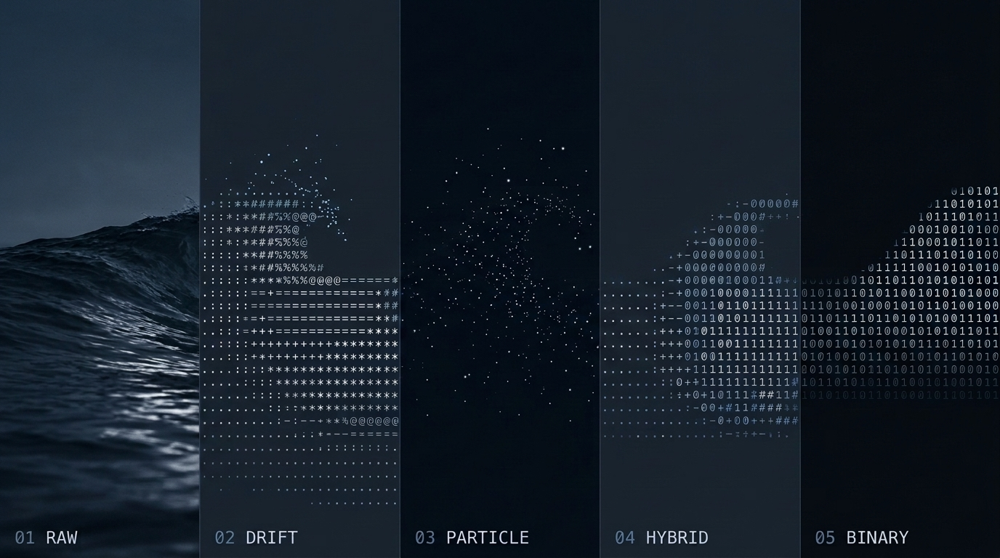

# Jefté Martins — Portfólio

Portfólio pessoal construído com **TypeScript**, **Vite** e **HTML5 Canvas 2D**, com um motor gráfico próprio em tempo real que desconstrói progressivamente o plano de fundo em 5 estágios visuais conforme o scroll da página.

<p align="center">
  
</p>

## Destaques

- **Motor de desconstrução visual a 60 FPS** ([`ascii-deconstructor`](https://github.com/JefteMartins/ascii-deconstructor)):
  - **01 · RAW** — Mídia de fundo limpa com paralaxe sutil pelo cursor e crossfade contínuo A/B (`0.5s`) para loop de vídeo sem saltos.
  - **02 · DRIFT** — Rasterização ASCII de alta densidade com partículas que se desprendem pelo delta de movimento entre frames.
  - **03 · PARTICLE** — Campo espacial de partículas guiado por luminância.
  - **04 · HYBRID** — Matriz híbrida combinando glifos ASCII e dígitos binários.
  - **05 · BINARY** — Limiarização dinâmica por percentil de luminância (`0`/`1`) preservando a silhueta em qualquer imagem.
- **Modo interativo de mídia**: teste qualquer imagem local nos 5 estágios usando **`Alt + I`**, o botão da barra inferior ou **`Shift + arrastar e soltar`**.
- **Conteúdo 100% orientado a dados**: textos, experiências, stack, projetos (públicos e privados) e contatos centralizados em [`src/data/portfolio.json`](src/data/portfolio.json).
- **Acessibilidade e performance**: respeita `prefers-reduced-motion: reduce`, pausa renderização fora de foco (`visibilitychange`) e usa `Uint32Array` + cache esparso de carimbos de glifos (zero `fillText` por quadro).

## Stack

| Camada | Tecnologias |
| --- | --- |
| Core & Build | TypeScript 5, Vite 6 |
| Renderização | HTML5 Canvas 2D, `Uint32Array`, Offscreen Sampling |
| Tipografia | JetBrains Mono (`@fontsource/jetbrains-mono`), sistema sans-serif |
| Conteúdo | JSON tipado ([`src/types.ts`](src/types.ts)) + currículo oficial em PDF |

## Estrutura do Projeto

```text
.
├── index.html
├── public/
│   ├── curriculo.pdf                   # Currículo oficial em inglês (PDF)
│   ├── favicon.svg
│   └── assets/
│       ├── background.jpg              # Fallback estático do fundo
│       ├── background.mp4              # Vídeo principal em loop A/B
│       ├── project-ascii-engine.jpg    # Preview dos 5 estágios do motor
│       ├── project-organizador-aulas.png
│       └── project-goodhamburguer.png
└── src/
    ├── main.ts                         # Renderização, telemetria, modal e atalhos
    ├── style.css                       # Sistema visual editorial e responsivo
    ├── types.ts                        # Contratos TypeScript dos dados
    ├── data/
    │   └── portfolio.json              # Fonte única de conteúdo
    └── engine/
        └── asciiDeconstructor.ts       # Motor gráfico ASCII/Binário
```

## Executando Localmente

**Pré-requisitos:** Node.js 18+ e npm.

```bash
# Instalar dependências
npm install

# Rodar em desenvolvimento (com acesso na rede local)
npm run dev

# Gerar build de produção (typecheck + bundle em dist/)
npm run build

# Pré-visualizar build de produção
npm run preview
```

## Como Atualizar Conteúdo

- **Textos, trajetória, stack e projetos:** edite [`src/data/portfolio.json`](src/data/portfolio.json).
  - Projetos **públicos** definem `"visibility": "public"` e `"repoUrl"`.
  - Projetos **privados** definem `"visibility": "private"` (sem `repoUrl`) e exibem automaticamente o CTA direcionando para a seção `#contato`.
- **Currículo PDF:** substitua [`public/curriculo.pdf`](public/curriculo.pdf).

## Projetos em Destaque

1. **[Motor de Desconstrução Visual ASCII/Binário](https://github.com/JefteMartins/ascii-deconstructor)** *(Open Source)*
2. **HorarioProfs — Organizador de Aulas** *(Repositório privado)*
3. **[GoodHamburguer — API .NET & Operações Blazor](https://github.com/JefteMartins/GoodHamburguer)** *(Open Source)*

---

Desenvolvido por **Jefté Martins** — [LinkedIn](https://www.linkedin.com/in/jeftemartins) · [GitHub](https://github.com/JefteMartins)
